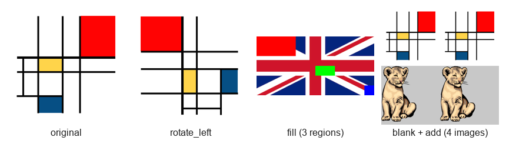

# Scrim: an Image-Processing Script Interpreter in C++

A command-line program that reads **scrim** scripts (simple text files with one image operation per line) and applies them to PNG images: rotations, mirrors, crops, colour transformations, compositing and more.

Developed for the **Programming** course (L.EIC009) of the Bachelor in Informatics and Computing Engineering at FEUP (University of Porto), 2024/25, by André Baptista ([@andrefb26](https://github.com/andrefb26)) and two classmates.

<p align="center"></p>

## Example

```text
open input/mondrian.png
rotate_left
fill 0 0 100 50 255 0 0
save output/result.png
```

```bash
./runscrim scrims/rotate_left1.scrim scrims/fill2.scrim
```

## Supported commands

| Category | Commands |
|---|---|
| Input / output | `open`, `save`, `blank` (new image filled with a colour) |
| Colour | `invert`, `to_gray_scale`, `replace` (swap one colour for another), `fill` (paint a rectangle) |
| Geometry | `h_mirror`, `v_mirror`, `rotate_left`, `rotate_right`, `crop`, `resize`, `scaleup`, `move`, `slide` |
| Composition | `add` (paste another image, treating one colour as transparent), `chain` (run other scrim files in sequence) |

## Design

- **Command pattern:** every operation is a subclass of the abstract `Command`, with a virtual `apply(Image*)`. A script is a list of commands applied in order. Commands that change the image size return a new `Image`, and the old one is freed.
- **`ScrimParser`** reads a script, validates the arguments of each command and builds the corresponding `Command` objects. `chain` runs other scripts recursively.
- **`Image` and `Color`** form the in-memory representation, a dynamically allocated grid of RGB pixels. PNG files are read and written with the single-header `stb_image` library.
- **Memory safety:** the project builds with `-Wall -pedantic -Werror` and, on Linux/macOS, with AddressSanitizer and UndefinedBehaviorSanitizer.

## Testing

`main/Tester.cpp` runs every script in `scrims/` and compares each result, pixel by pixel, with the reference image in `expected/`. The implementation passes the full test suite (70+ scripts).

## My contribution

The course provided the project skeleton (PNG input/output, the `Command` interface and the tester), and the base classes and the basic `open` / `save` / `blank` commands were set up together with my teammates. I implemented most of the image commands: `invert`, `to_gray_scale`, `replace`, `fill`, `h_mirror`, `v_mirror`, `add`, `crop`, `rotate_left`, `rotate_right`, `move`, `slide`, `resize`, `scaleup` and `chain`. I also wrote most of the parser logic for them.

## Building

Requirements: a C++17 compiler and CMake 3.15+.

```bash
cmake -S . -B build
cmake --build build
./build/runscrim scrims/add3.scrim     # run one or more scripts
./build/tester                         # run the full test suite
```

## Project structure

```
include/, src/      Image, Color, Scrim, ScrimParser and one class per command
main/               runscrim (script runner) and the tester
scrims/             test scripts
input/, expected/   input images and reference outputs
```
